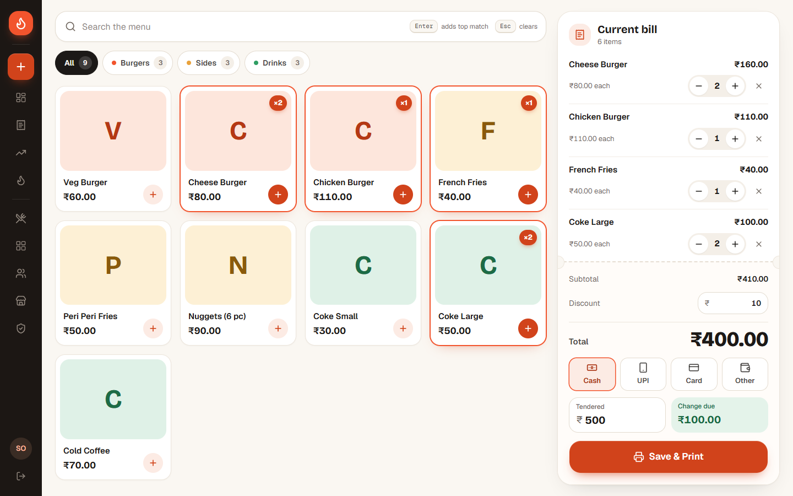
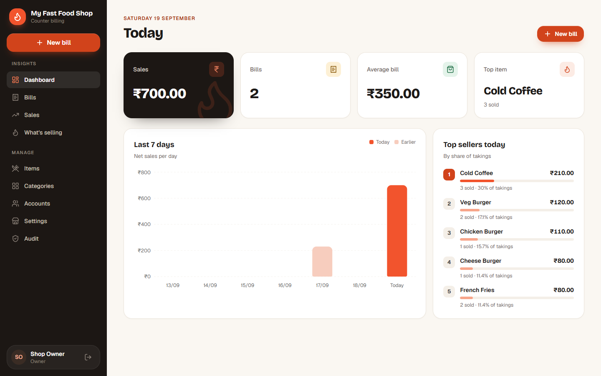
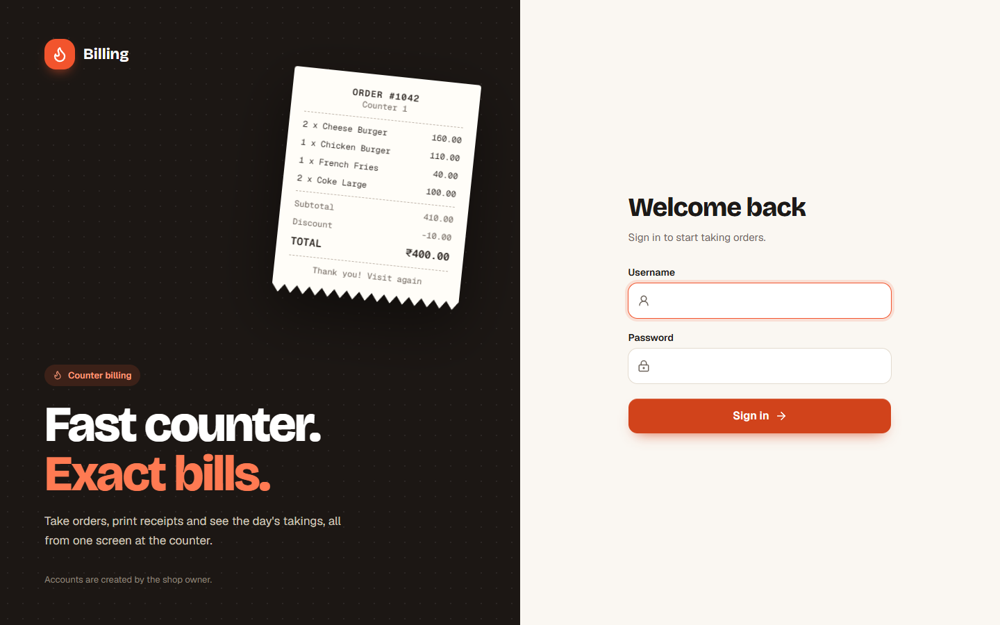

# Billing

A fast, exact counter POS for a single-outlet fast food shop. Cashiers ring up
orders from a touch- and keyboard-friendly till and print thermal receipts; the
owner manages the menu, prices, accounts and shop details, and follows the day's
takings on a live dashboard.



<table>
  <tr>
    <td></td>
    <td></td>
  </tr>
</table>

## Features

**At the counter**

- Menu grid with category chips, item photos (or colour-coded tiles) and
  sold-out states; items already on the bill show their quantity.
- Keyboard-first search: type, <kbd>Enter</kbd> adds the top match,
  <kbd>Esc</kbd> clears.
- Discounts, Cash / UPI / Card / Other payments, and change due for cash.
- Save & Print to 80mm or 58mm thermal printers, plus reprints from history.
- A clear offline banner, so nobody hands over food for a bill that never saved.

**For the owner**

- Dashboard: today's sales, bills, average bill, top item, the last 7 days and
  top sellers.
- Bills ledger with date, cashier, payment and bill-number filters.
- Sales and "What's selling" reports with date-range presets and CSV export.
- Manage items (with photos), categories, cashier accounts and shop settings,
  with a live receipt preview.
- One-click export of all data as CSV for off-site backup.

**Built to keep the books right**

- Money is handled as exact decimal strings end to end — never floating point.
- Prices are always re-read on the server; the browser only sends item IDs and
  quantities.
- Saving is idempotent: a retry after a timeout cannot create a second bill.
- Bill numbers are gapless, and database triggers stop past bills from being
  rewritten.
- Items, categories and accounts are deactivated, never deleted, so history
  stays intact.
- Every page and server action checks the signed-in role; repeated failed
  sign-ins lock the account temporarily.

## Tech stack

| Layer     | Choice                                                                               |
| --------- | ------------------------------------------------------------------------------------ |
| Framework | [Next.js 16](https://nextjs.org) (App Router, Server Actions)                        |
| Language  | TypeScript                                                                           |
| Database  | [Neon](https://neon.tech) Postgres via [Drizzle ORM](https://orm.drizzle.team)       |
| Auth      | [Auth.js v5](https://authjs.dev) (credentials, JWT sessions)                         |
| UI        | Tailwind CSS v4, [shadcn/ui](https://ui.shadcn.com) on Radix, lucide icons, Recharts |
| Money     | [big.js](https://github.com/MikeMcl/big.js)                                          |
| Images    | [ImageKit](https://imagekit.io)                                                      |
| Hosting   | [Netlify](https://www.netlify.com)                                                   |
| Tooling   | ESLint, Prettier (with Tailwind class sorting), tsx scripts                          |

## Getting started

### Prerequisites

- **Node.js 20.9 or later** (production runs Node 22)
- A free [Neon](https://console.neon.tech) Postgres project
- Optional: an [ImageKit](https://imagekit.io) account for item photos

### Setup

```bash
# 1. Install dependencies
npm install

# 2. Configure the environment
cp .env.template .env.local
#    then fill in the values — see the table below
npx auth secret            # generates a value for AUTH_SECRET

# 3. Create the schema and the first owner account
npm run db:migrate
npm run db:seed

# 4. Start the app
npm run dev
```

Open <http://localhost:3000> and sign in with the `SEED_SUPERADMIN_USERNAME` and
`SEED_SUPERADMIN_PASSWORD` you set. The seed also adds a small sample menu and
the shop's details, which you can change under **Settings**. Clear the seed
password from `.env.local` once you have signed in.

### Environment variables

| Variable            | Required      | Notes                                                           |
| ------------------- | ------------- | --------------------------------------------------------------- |
| `DATABASE_URL`      | Yes           | Neon **pooled** connection string (contains `-pooler`)          |
| `AUTH_SECRET`       | Yes           | Generate with `npx auth secret`                                 |
| `AUTH_URL`          | Yes           | `http://localhost:3000` locally; the deployed URL in production |
| `IMAGEKIT_*`        | For photos    | ImageKit keys and URL endpoint (server only)                    |
| `SEED_SUPERADMIN_*` | For `db:seed` | The first owner account                                         |

`.env.template` documents each one. `.env.local` is git-ignored — never commit
real secrets.

## Scripts

| Script                                    | What it does                                                                    |
| ----------------------------------------- | ------------------------------------------------------------------------------- |
| `npm run dev`                             | Start the development server                                                    |
| `npm run build` / `npm start`             | Production build / serve it                                                     |
| `npm run lint` / `npm run lint:fix`       | ESLint                                                                          |
| `npm run format` / `npm run format:check` | Prettier — write / check                                                        |
| `npm run typecheck`                       | TypeScript, no emit                                                             |
| `npm run verify:offline`                  | Money, retry and report checks, typecheck, lint and format — no database needed |
| `npm run verify:all`                      | Everything above plus the database checks — **run before every deploy**         |
| `npm run db:generate`                     | Generate a migration after changing `src/db/schema`                             |
| `npm run db:migrate`                      | Apply migrations to `DATABASE_URL`                                              |
| `npm run db:seed`                         | Create the first owner, sample menu and settings                                |
| `npm run db:studio`                       | Browse the database in Drizzle Studio                                           |

The database checks run against whatever `DATABASE_URL` points at, so point it
at a development database first.

## Project structure

```
src/
├─ app/                  Routes. (app)/ is the signed-in shell; login/ and
│                        print/ render outside it.
├─ components/
│  ├─ ui/                shadcn/ui primitives, styled for the Ember design
│  ├─ layout/            Sidebar, mobile nav, page header, container
│  ├─ custom/            Shared components (table card, stat card, …)
│  └─ pages/             One folder per screen, with its hooks and parts
├─ server/               Server actions, queries and services per domain
├─ db/                   Drizzle schema, migrations and seed
└─ lib/                  Auth guards, money and date utilities, validation
scripts/                 Verification checks and database utilities
docs/                    Deployment, printer setup, specs and plans
```

## Code quality

- **Prettier** formats every file and sorts Tailwind classes; **ESLint**
  (Next.js rules) catches bugs. `eslint-config-prettier` keeps the two from
  conflicting.
- VS Code formats on save and applies ESLint fixes on save. Accept the
  recommended extensions when the workspace opens.
- There is no unit-test framework by design; the `verify:*` scripts check
  the money logic, database constraints and server actions directly.

Contributor conventions — the non-negotiable rules, folder layout, design
tokens and naming — are in [`CLAUDE.md`](CLAUDE.md).

## Deployment and operations

- [`docs/deployment.md`](docs/deployment.md) — Netlify and Neon setup,
  migrations, backups and free-tier behaviour
- [`docs/printer-setup.md`](docs/printer-setup.md) — one-time thermal printer
  setup on the till computer
